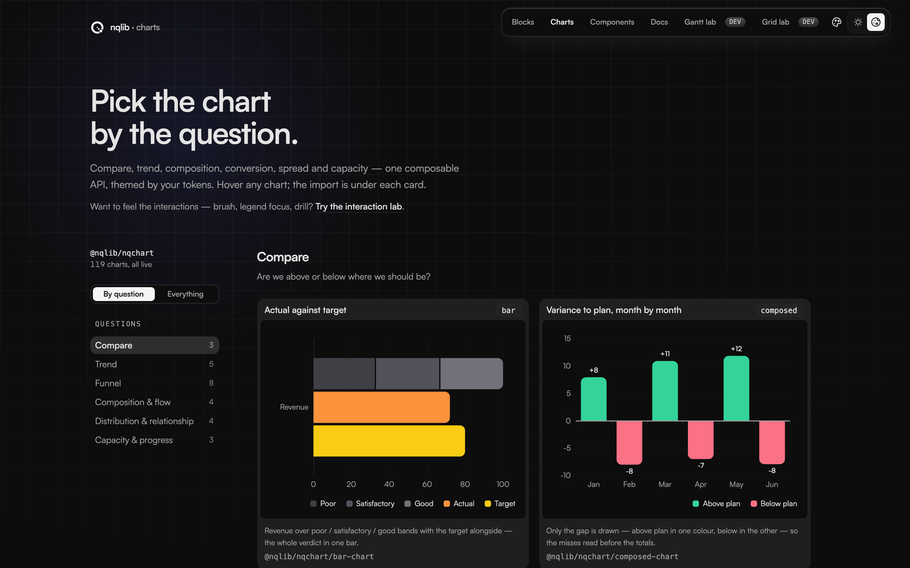

# @nqlib/nqchart

<p align="center">
  
</p>

Composable React charts. One component per question — bar, line, funnel, pie — themed by your tokens.

## Use

```bash
npm install @nqlib/nqchart echarts
```

```tsx
import { NQBarChart, Bar, Grid, XAxis, Tooltip } from "@nqlib/nqchart/bar-chart"
import type { ChartConfig } from "@nqlib/nqchart"

const config = {
  desktop: { label: "Desktop", color: "var(--chart-1)" },
} satisfies ChartConfig

export function Revenue({ data }: { data: { month: string; desktop: number }[] }) {
  return (
    <NQBarChart config={config} data={data} xDataKey="month" className="h-64 w-full">
      <Grid />
      <XAxis dataKey="month" />
      <Bar dataKey="desktop" />
      <Tooltip />
    </NQBarChart>
  )
}
```

Every chart, the recipes, and the interaction lab: [nqlib.com/docs/nqchart](https://nqlib.com/docs/nqchart)
